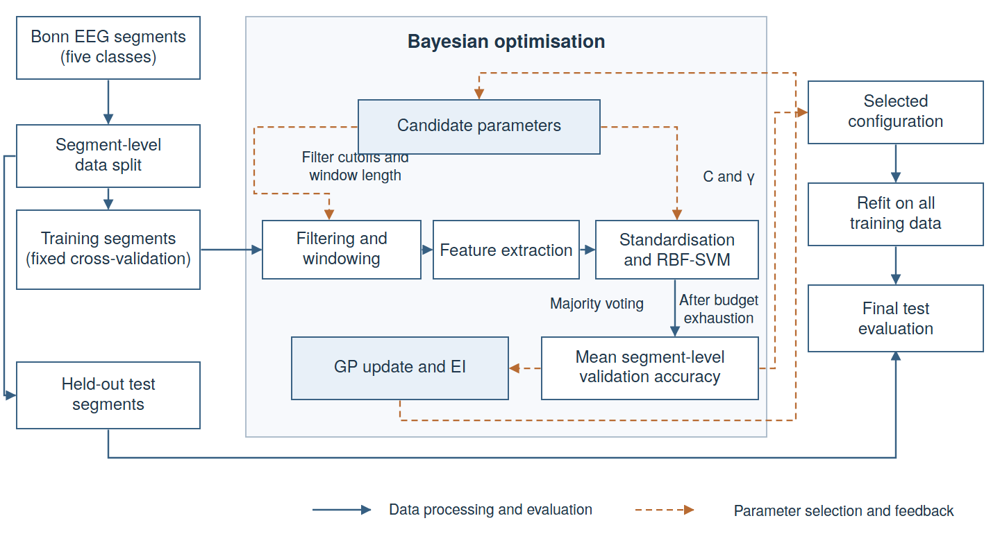
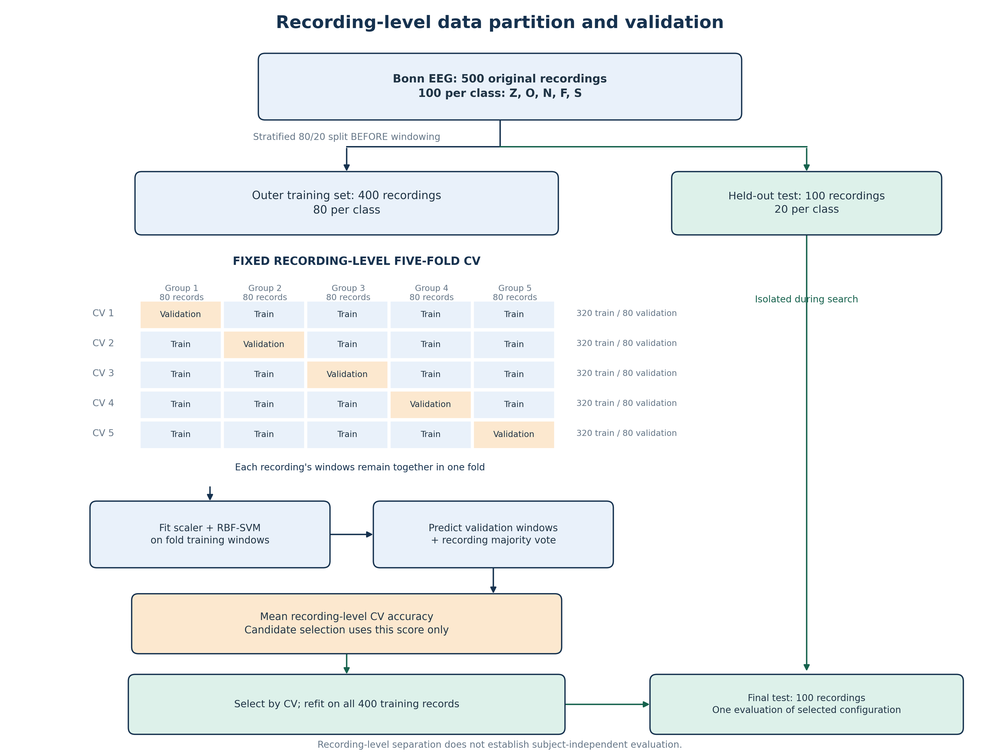

# 4.1 实现概述

本研究将贝叶斯优化（Bayesian optimisation，BO）与 EEG 分类程序连接，用于联合搜索信号预处理参数和径向基函数支持向量机（RBF-SVM）的超参数。第三章已介绍各组成方法的原理，本节着重说明其在程序中的连接方式。图 4.1 展示了从候选参数生成、训练集内验证到最终测试的实现流程。每个候选配置均经过完整的预处理、特征提取和分类评估，其验证结果随后返回 BO，作为后续搜索的依据。

**图 4.1　BO 控制的 EEG 分类实现流程。** 蓝色实线表示数据处理与评价，橙色虚线表示参数选择与反馈。训练 EEG 片段进入候选配置评估闭环，验证准确率经 GP 和 EI 反馈；搜索结束后，选定配置在全部训练数据上重新拟合，并仅在保留测试片段上进行最终评价。

程序首先为每条原始 EEG 记录保留唯一标识，并在生成窗口前完成训练集与测试集划分。优化器提出的候选配置包括带通滤波下限、带通滤波上限、窗口时长，以及 SVM 的惩罚参数 C 和核参数 γ。前三个参数决定当前配置下的信号表示：程序先对每条完整记录执行带通滤波，再划分为不重叠窗口，并对每个窗口提取固定的 55 维特征。C 和 γ 则用于构建该候选配置对应的分类器。因此，一次候选评估同时考察信号处理设置与分类器设置的组合效果，而不是仅在预先固定的特征矩阵上调整 SVM。

候选配置的评估仅在外层训练集内进行。程序根据原始记录标识固定五个交叉验证折，并将每条记录产生的所有窗口分配到该记录所在的折。各折分别拟合特征标准化器和 RBF-SVM，再对验证窗口进行预测。同一条验证记录的窗口预测通过多数投票合并为一个类别，随后计算该折的记录级分类准确率。五折准确率的算术平均值作为候选配置的验证得分。BO 的实现使用最小化接口，因此程序将该得分取负后返回优化器；本文报告和绘制搜索进展时仍使用正向准确率，即数值越高表示验证表现越好。

在完成初始候选评估后，BO 根据已观测的参数与验证得分更新高斯过程代理模型，并通过期望改进（expected improvement，EI）采集函数选择后续候选点。上述过程持续至达到预设的 50 次评估预算。程序随后选择验证得分最高的候选配置，在全部外层训练记录生成的窗口上重新拟合标准化器和 SVM，最后对保留的测试记录执行相同的预处理、特征提取与多数投票。每次搜索完成后，仅对其选定配置进行一次保留测试集评估。由此，候选选择依据来自训练集内验证，最终报告的测试指标则用于评价选定配置在未参与该次搜索的记录上的表现。

# 4.2 数据与实验设置

## 4.2.1 数据集与分类任务

本研究采用 Bonn EEG 数据集构建五分类任务。该数据集包含五组单通道 EEG 片段，每组 100 条，共计 500 条，采样率为 173.61 Hz，单条时长约为 23.6 s。原始研究以 A–E 表示五组数据，发布文件则分别使用 Z、O、N、F 和 S 作为前缀，本文沿用文件前缀作为类别名称。Z、O 来自健康志愿者睁眼和闭眼时的头皮 EEG；N、F 分别来自癫痫患者发作间期的对侧海马和致痫区；S 对应发作期活动。各组的对应关系见表 4.1（Andrzejak et al., 2001）。本地实际加载的 500 个文件均包含 4,097 个采样点，本文按文件实际长度读取，不人为截短为 4,096 点。

**表 4.1　Bonn 五分类数据及外层划分。**

| 本文类别 | 原始分组 | 信号来源与状态 | 总记录数 | 外层训练记录数 | 外层测试记录数 |
|---|---|---|---:|---:|---:|
| Z | A | 健康志愿者，睁眼，头皮 EEG | 100 | 80 | 20 |
| O | B | 健康志愿者，闭眼，头皮 EEG | 100 | 80 | 20 |
| N | C | 发作间期，对侧海马，颅内 EEG | 100 | 80 | 20 |
| F | D | 发作间期，致痫区，颅内 EEG | 100 | 80 | 20 |
| S | E | 发作期，颅内 EEG | 100 | 80 | 20 |
| 合计 | — | — | 500 | 400 | 100 |

本文将数据集发布的单个 EEG 片段称为一条“原始记录”，将其进一步截取的短片段称为“窗口”。这里的记录级划分以发布文件为单位，并非以受试者或连续采集时段为单位。[数据发布说明](https://www.upf.edu/web/ntsa/downloads/-/asset_publisher/xvT6E4pczrBw/content/2001-indications-of-nonlinear-deterministic-and-finite-dimensional-structures-in-time-series-of-brain-electrical-activity-dependence-on-recording-regi)指出，片段与具体受试者及记录接触点的对应信息未提供，因此本实验不能据此建立受试者独立的测试集，也不能将记录级测试结果解释为跨受试者泛化能力。

## 4.2.2 数据划分与记录级交叉验证

如图 4.2 所示，每次实验先按类别分层，将原始记录以 80%∶20% 划分为外层训练集和保留测试集，分别包含 400 条和 100 条记录。测试集每类含 20 条记录，并在该次参数搜索过程中保持隔离。训练集内采用记录级固定五折交叉验证，每折使用 320 条记录训练、80 条记录验证。分折程序先根据唯一记录标识确定折归属，再将该归属应用到当前候选配置生成的窗口上。由此，即使窗口时长改变，各条原始记录所属的验证折仍保持不变，同一记录的窗口也不会同时出现在训练折与验证折中。

**图 4.2　原始记录划分与训练集内验证。** 500 条原始记录首先分为 400 条训练记录和 100 条测试记录。图中五折示意每轮验证使用一个记录子集，其余四个子集用于训练；各折为 320 条训练记录和 80 条验证记录。窗口继承原始记录的折归属。参数搜索仅使用训练集内的五折验证得分，选定配置后在全部 400 条训练记录上重新拟合模型，再评估 100 条测试记录。

特征标准化与 SVM 被封装在同一训练流程中。每折的标准化均值和标准差只根据该折训练窗口估计，再应用于对应的验证窗口；最终测试时，标准化器仅根据全部外层训练窗口重新拟合。滤波、分窗和逐窗口特征计算不依赖其他记录的统计量，因此可在各记录上独立执行。上述安排既控制了同一原始记录的窗口跨折问题，也避免验证数据或测试数据参与标准化参数估计。

候选配置的选择指标为五折平均记录级 accuracy。同一记录的窗口预测采用硬多数投票；当多个类别票数相同时，程序按固定标签顺序 Z、O、N、F、S 选择索引最小的类别。最终评估以记录级 accuracy 为主要指标，并结合记录级 macro-F1、各类 recall 和混淆矩阵分析错误分布。窗口级指标作为补充结果单独报告，不与记录级指标混用。本文所称“验证得分”均指训练集内交叉验证结果，“测试得分”则指保留测试记录上的结果。

## 4.2.3 信号预处理与特征设置

对每个候选配置，程序先采用四阶 Butterworth 带通滤波器处理完整记录，并以二阶节形式进行前向和反向滤波。滤波截止频率由当前候选参数确定。随后按候选窗口时长生成不重叠窗口，窗口采样点数取窗口时长与采样率乘积的四舍五入值；记录末尾不足一个完整窗口的部分舍弃。主实验未额外加入陷波、重采样或伪迹剔除步骤。由于窗口时长参与优化，不同候选配置产生的窗口数量可能不同，但外层记录划分、交叉验证折归属和记录级评分单位保持一致。

所有比较统一采用程序中的 nf_enhanced 特征设置，每个窗口输出 55 列特征，其组成见表 4.2。频域特征基于 Welch 功率谱密度估计，单段长度取 256 与当前窗口采样点数中的较小者；δ、θ、α、β 和 γ 频带分别设为 0.5–4、4–8、8–13、13–30 和 30–40 Hz。此处 γ 频带与 SVM 核参数 γ 含义不同。滤波上限的搜索范围虽然扩展至 60 Hz，频带功率特征的最高频段仍固定为 30–40 Hz，其他时域、熵和小波特征则直接从滤波后窗口计算。

**表 4.2　主实验的窗口特征组成。**

| 特征组 | 具体内容 | 列数 |
|---|---|---:|
| 频带功率 | 五个频带的绝对功率与相对功率 | 10 |
| 频带比值 | δ/θ、θ/α、α/β、β/γ、(δ+θ)/(α+β)、γ/五频带总功率 | 6 |
| 时域统计 | 均值、标准差、方差、最大值、最小值、中位数、峰峰值、均方根、线长、偏度、峰度、能量、去均值后的过零次数 | 13 |
| 熵 | 幅值 Shannon 熵、谱熵、近似熵 | 3 |
| Hjorth 参数 | 活动性、移动性、复杂性 | 3 |
| 小波特征 | db4 三级分解的 A3、D3、D2、D1，每组提取能量、相对能量、系数能量熵、均值和标准差 | 20 |
| 合计 | 固定保留上述特征列 | 55 |

幅值 Shannon 熵使用 32 个直方图区间，近似熵设置嵌入维数为 2、容差为所用序列标准差的 0.2 倍；为控制重复搜索的计算量，近似熵计算前将较长窗口按等间隔索引抽取至最多 80 个点。小波特征通过 PyWavelets 计算，程序检查输出特征是否为 55 列。计算所得的非有限数值统一替换为零。本实验固定使用这些特征列，未在主比较中追加特征选择或去重；因此，55 表示输入列数，而不表示 55 个彼此独立的信息维度。

## 4.2.4 参数范围与四种映射

联合搜索包含三个预处理参数和两个 SVM 参数，取值范围见表 4.3。所有比较均使用 RBF 核，并固定 class_weight 为 balanced。手动配置提供一个预先指定的参考点，随机搜索与 BO 则在相同物理参数边界内寻找候选配置。

**表 4.3　联合搜索范围与手动参考配置。**

| 参数 | 含义 | 搜索范围 | 坐标设置 | 手动配置 |
|---|---|---|---|---:|
| f_low | 带通下限 | 0.5–5 Hz | 四种映射之一 | 0.5 Hz |
| f_high | 带通上限 | 30–60 Hz | 四种映射之一 | 40 Hz |
| window_size | 窗口时长 | 1–5 s | 四种映射之一 | 2 s |
| C | SVM 惩罚参数 | 0.1–100 | 对数坐标 | 10 |
| γ | RBF 核参数 | 10⁻⁴–1 | 对数坐标 | 0.1 |

四种映射仅作用于 f_low、f_high 和 window_size，分别为均匀、正态、指数和 Gamma 映射，设置见表 4.4。均匀设置直接使用原始物理参数范围；其余三种设置在接近 0–1 的潜在坐标中搜索，再通过相应分布在指定边界内的截断逆累积分布函数转换为物理参数。程序为避免逆变换端点的数值问题，将非均匀映射的潜在坐标限制在 10⁻⁶ 至 1−10⁻⁶。这里的分布用于定义参数搜索坐标与物理参数之间的关系，既不是对 EEG 信号分布的拟合，也不是四种不同的高斯过程核。由于映射改变了搜索坐标中的距离关系，其影响也不局限于初始点的分布。

**表 4.4　三项预处理参数的映射设置。** 设参数下界为 a、上界为 b，范围宽度为 w=b−a；非均匀分布均在 [a,b] 内截断并归一化。

| 映射名称 | 基础分布设置 | 实现方式 |
|---|---|---|
| 均匀（uniform） | [a,b] 内均匀设置 | 直接搜索物理参数；等价于线性坐标映射 |
| 正态（normal） | 均值 (a+b)/2，标准差 w/4 | 截断正态分布的逆 CDF |
| 指数（exponential） | 位置参数 a，尺度参数 w/3 | 截断指数分布的逆 CDF |
| Gamma（gamma） | 形状参数 2，位置参数 a，尺度参数 w/4 | 截断 Gamma 分布的逆 CDF |

四种设置中的 C 和 SVM γ 均保持相同的对数坐标范围，不参与上述映射变换。随机搜索对三个预处理参数采用范围内均匀抽样，对 C 和 γ 采用对数均匀抽样。BO 则使用高斯过程代理模型和 EI 采集函数，在候选评估完成后依据验证得分继续选择参数。两种搜索方法采用相同的记录级目标、预处理与特征实现，但随机搜索不会根据已有验证结果调整后续抽样。

## 4.2.5 搜索预算、重复运行与比较条件

实验分为三方法基线比较与四映射比较，具体设置见表 4.5。三方法比较使用种子 42 对应的同一外层划分与记录级五折，比较手动配置、随机搜索和均匀映射 BO。手动方法仅评估一个固定配置；随机搜索和 BO 分别评估 50 个候选配置，其中 BO 的 16 个初始候选点计入总预算，其余 34 次评估由代理模型和采集函数引导。因此，两种搜索方法的预算以候选配置评估次数匹配，而非以实际运行时间匹配；窗口数量及特征计算开销随候选配置变化，各方法的运行时间未必相同。

**表 4.5　比较实验的预算与控制条件。**

| 设置 | 三方法基线比较 | 四映射比较 |
|---|---|---|
| 比较对象 | 手动配置、随机搜索、均匀映射 BO | 均匀、正态、指数、Gamma 映射 BO |
| 随机种子 | 42 | 42、43、44、45、46 |
| 外层划分 | 记录级分层 80%/20% | 每个种子下四种映射共用同一划分 |
| 内层验证 | 训练集内固定记录级五折 | 每个种子下四种映射共用同一组固定折 |
| 候选评估预算 | 手动 1 次；随机搜索、BO 各 50 次 | 每种映射、每个种子各 50 次 |
| BO 初始评估 | 16 次，包含在 50 次内 | 每次运行 16 次，包含在 50 次内 |
| BO 后续评估 | 34 次，GP 与 EI 引导 | 每次运行 34 次，GP 与 EI 引导 |
| 共同分类设置 | 55 列特征、折内标准化、RBF-SVM、balanced 类别权重、硬多数投票 | 同左 |
| 候选选择依据 | 五折平均记录级 accuracy | 同左 |
| 最终测试 | 每个方法选定配置后评估一次 | 每次搜索选定配置后评估一次 |

四映射实验共完成 20 次 BO 搜索。对同一随机种子，四种映射使用相同外层训练与测试记录、相同交叉验证折、相同特征与分类器设置，以及相同评估预算，从而使比较集中于参数映射的改变。跨种子实验同时改变数据划分及搜索随机过程，因此重复结果的波动反映这两方面的共同影响，不能全部归因于优化器随机性。五个外层划分之间还可能共享记录，后续均值与标准差应作为重复划分下的描述性统计解释，不能视为五个独立外部数据集上的验证。

三方法比较目前只在种子 42 下完成，因而该比较能够说明给定划分和预算下的差异，但不足以单独判断三种方法的跨运行稳定性。四映射的五种子结果用于补充考察映射相关的波动，不能代替随机搜索与手动方法的重复实验。后续章节将分别报告这两组比较，并以训练集内验证过程解释搜索进展，保留测试结果用于最终性能描述，不依据测试得分反向调整参数或宣称某种映射已被确认为最优。

# 参考文献

Andrzejak, R. G., Lehnertz, K., Mormann, F., Rieke, C., David, P., & Elger, C. E. (2001). [Indications of nonlinear deterministic and finite-dimensional structures in time series of brain electrical activity: Dependence on recording region and brain state](https://doi.org/10.1103/PhysRevE.64.061907). *Physical Review E, 64*, 061907.

数据发布说明：[The Bonn EEG time series download page](https://www.upf.edu/web/ntsa/downloads/-/asset_publisher/xvT6E4pczrBw/content/2001-indications-of-nonlinear-deterministic-and-finite-dimensional-structures-in-time-series-of-brain-electrical-activity-dependence-on-recording-regi)。记录与受试者对应信息是否可用以该说明为依据；采样点数以本地实际加载文件为依据。
